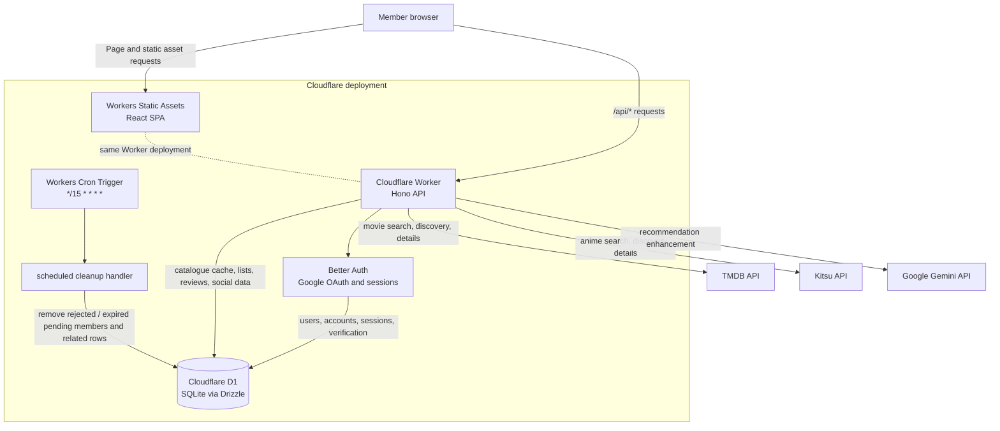
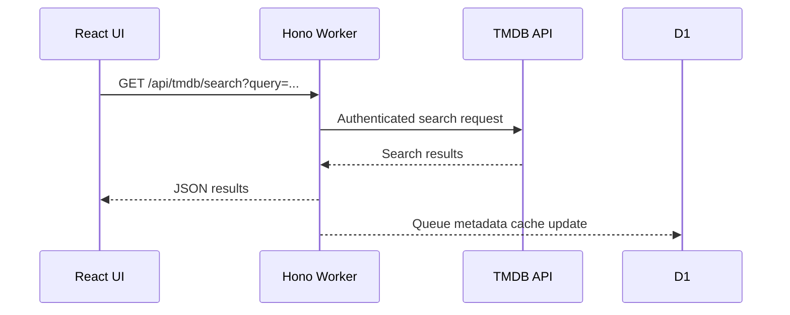
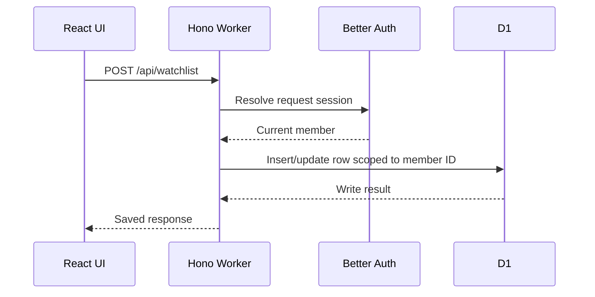
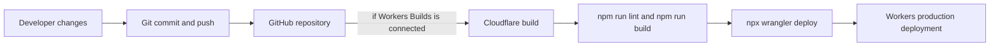

# Architecture

## System architecture

### Routing and runtime

- `wrangler.jsonc` sets `main` to `worker/index.ts` and enables the Workers Assets single-page-app fallback.
- The `run_worker_first: ["/api/*"]` rule ensures API requests reach Hono instead of being answered by the SPA fallback.
- The React app and Worker API are deployed together as one Cloudflare Worker application.
- The Worker receives the D1 database through the `movie_hunt_db` binding.

### Frontend

React and TypeScript implement the client UI. Vite builds the frontend and integrates with the Cloudflare Vite plugin. React Router handles application navigation, including the Movies/Anime mode. Movie and anime catalogues, watchlists, and reviews remain separate in the application and database.

### Worker API

The Hono application in `worker/index.ts` groups responsibilities into:

- Better Auth endpoints at `/api/auth/*` and current-member status at `/api/me`.
- Administrator approval endpoints under `/api/admin/*`.
- TMDB movie discovery and details under `/api/tmdb/*`.
- Movie watchlists and reviews under `/api/watchlist*` and `/api/reviews/*`.
- Kitsu anime catalogue and personal library endpoints under `/api/anime/*`.
- Movie and anime recommendation endpoints under `/api/recommendations` and `/api/anime/recommendations`.
- Member directory, friendships, privacy, activity feed, and shared recommendations under `/api/social/*`.

### Authentication and member lifecycle

Better Auth handles Google OAuth and session storage through the D1-backed Drizzle adapter. Movie Hunt extends the user record with `role`, `approval_status`, `approval_expires_at`, and `approved_at` fields.

- An email in `ADMIN_EMAILS` is assigned administrator/approved status when its user record is created.
- Other new users start as pending and receive a 24-hour approval window.
- Session/member checks reject expired pending or rejected accounts.
- A scheduled handler runs every 15 minutes and removes rejected accounts and pending accounts whose approval deadline has passed, including their related personal and social rows.

The administrator allowlist is applied during account creation; changing `ADMIN_EMAILS` does not by itself promote a user row that already exists.

### Data providers and recommendation flow

- **TMDB:** the Worker sends authenticated requests using `TMDB_ACCESS_TOKEN`. Movie and genre metadata is cached in D1 as users browse and request details.
- **Kitsu:** the Worker requests the public Kitsu JSON:API for anime discovery and search. Anime metadata is cached when a member adds an anime to a personal list or saves an anime review; the full external catalogue is not bulk-imported.
- **Gemini:** recommendation endpoints build a candidate set from provider data and the current member's own watchlist/review signals. Gemini can contribute recommendation selection/explanations. If Gemini does not return a usable response, the prompt-aware local algorithm provides a fallback. Movie and anime recommendations use separate profiles and candidate catalogues.

## Movie discovery request flow

## Personal watchlist request flow

## Deployment flow

D1 migrations are intentionally separate from the application deployment flow. Review new SQL migrations and apply them to the intended D1 environment separately.
