# Database Design

Movie Hunt uses Cloudflare D1 (SQLite) with Drizzle ORM.

## Entity relationship diagram

```mermaid
erDiagram
    USER ||--o{ ACCOUNT : has
    USER ||--o{ SESSION : has
    USER ||--o{ WATCHLIST_ITEMS : owns
    USER ||--o{ USER_REVIEWS : writes
    USER ||--o{ ANIME_WATCHLIST_ITEMS : owns
    USER ||--o{ ANIME_REVIEWS : writes
    USER ||--o{ FRIENDSHIPS : user_a
    USER ||--o{ FRIENDSHIPS : user_b
    USER ||--o{ FRIENDSHIPS : requested_by
    USER ||--o| SOCIAL_PRIVACY : configures
    USER ||--o{ SHARED_RECOMMENDATIONS : sender
    USER ||--o{ SHARED_RECOMMENDATIONS : recipient

    MOVIES ||--o{ WATCHLIST_ITEMS : tracked_in
    MOVIES ||--o{ USER_REVIEWS : reviewed_in
    MOVIES ||--o{ MOVIE_GENRES : classified_by
    GENRES ||--o{ MOVIE_GENRES : maps

    ANIME_CATALOG ||--o{ ANIME_WATCHLIST_ITEMS : tracked_in
    ANIME_CATALOG ||--o{ ANIME_REVIEWS : reviewed_in

    USER {
        text id PK
        text name
        text email UK
        integer email_verified
        text image
        text role
        text approval_status
        integer approval_expires_at
        integer approved_at
    }
    ACCOUNT {
        text id PK
        text account_id
        text provider_id
        text user_id FK
        text access_token
        text refresh_token
    }
    SESSION {
        text id PK
        text token UK
        text user_id FK
        integer expires_at
    }
    VERIFICATION {
        text id PK
        text identifier
        text value
        integer expires_at
    }
    MOVIES {
        integer id PK
        integer tmdb_id UK
        text title
        text overview
        text poster_path
        text backdrop_path
        real vote_average
    }
    GENRES {
        integer tmdb_id PK
        text name
    }
    MOVIE_GENRES {
        integer movie_id PK,FK
        integer genre_id PK,FK
    }
    WATCHLIST_ITEMS {
        text id PK
        text user_id FK
        integer movie_id FK
        text status
        integer watched_at
    }
    USER_REVIEWS {
        text id PK
        text user_id FK
        integer movie_id FK
        real rating
        text review
    }
    ANIME_CATALOG {
        text kitsu_id PK
        text title
        text synopsis
        text poster_url
        real average_rating
        text genres_json
    }
    ANIME_WATCHLIST_ITEMS {
        text id PK
        text user_id FK
        text anime_id FK
        text status
        integer watched_at
    }
    ANIME_REVIEWS {
        text id PK
        text user_id FK
        text anime_id FK
        real rating
        text review
    }
    FRIENDSHIPS {
        text id PK
        text user_a_id FK
        text user_b_id FK
        text requested_by_id FK
        text status
    }
    SOCIAL_PRIVACY {
        text user_id PK,FK
        integer share_activity
        integer allow_friend_requests
    }
    SHARED_RECOMMENDATIONS {
        text id PK
        text sender_id FK
        text recipient_id FK
        text media_type
        text media_id
        text title
        text poster_url
        text message
        integer read_at
    }
    APP_SETTINGS {
        text key PK
        text value
        integer updated_at
    }
```



`VERIFICATION` is intentionally not connected to `USER` by a foreign key in the supplied migration: it stores an `identifier` and verification value.

## Tables at a glance

There are **16 application tables** in the current migration set.

| Table | Purpose | Important constraints |
|---|---|---|
| `user` | Better Auth profile plus Movie Hunt role and approval state | Unique email; role and approval fields are application-managed |
| `account` | OAuth provider account records | FK to `user`; unique `(provider_id, account_id)` |
| `session` | Login sessions | FK to `user`; unique session token |
| `verification` | Better Auth verification records | Indexed by `identifier`; no user FK in this schema |
| `movies` | Cached TMDB movie metadata | Unique `tmdb_id`; internal integer primary key |
| `genres` | TMDB genre catalogue | `tmdb_id` primary key |
| `movie_genres` | Movie/genre many-to-many mapping | Composite primary key `(movie_id, genre_id)` |
| `watchlist_items` | Per-user movie tracking | Unique `(user_id, movie_id)`; indexed by user/status |
| `user_reviews` | Per-user movie rating and review | Unique `(user_id, movie_id)` |
| `anime_catalog` | Cached Kitsu anime metadata | `kitsu_id` text primary key; genres stored as JSON text |
| `anime_watchlist_items` | Per-user anime tracking | Unique `(user_id, anime_id)`; indexed by user/status |
| `anime_reviews` | Per-user anime rating and review | Unique `(user_id, anime_id)` |
| `friendships` | Friend requests and accepted friendships | Unique `(user_a_id, user_b_id)` pair; initiator stored in `requested_by_id` |
| `social_privacy` | Activity sharing and friend-request preference | One row per user; activity sharing defaults off |
| `shared_recommendations` | Recommendations shared between friends | Sender and recipient both reference `user` |
| `app_settings` | Application-level key/value settings | Not intended for credentials or API secrets |

## Key relationships and ownership

- A movie row is keyed internally by `movies.id`; its external TMDB identifier is `movies.tmdb_id`.
- Movie watchlists and reviews reference the internal `movies.id`.
- `movie_genres` links `movies.id` to `genres.tmdb_id`.
- Anime rows are keyed by the external Kitsu ID (`anime_catalog.kitsu_id`); anime lists and reviews reference that string ID.
- Movie and anime watchlists/reviews include `user_id`, so personal data is scoped to the signed-in member in the Worker queries.
- The catalogue tables contain shared metadata caches. They are not personal libraries.
- Friendship rows reference both participants and the account that initiated the request.
- Shared recommendations reference a sender and recipient, and store whether the recipient has read the item.

## Status and privacy fields

Both movie and anime list tables use the same status strings in the Worker:

- `want_to_watch`
- `watching`
- `watched`
- `dropped`

The `social_privacy.share_activity` field defaults to `false`, and `allow_friend_requests` defaults to `true` in the supplied schema. The social feed reads movie/anime list and review activity only for accepted friends who enabled activity sharing.

## Migration history

| Migration | Tables / changes |
|---|---|
| `0000_huge_eddie_brock.sql` | `app_settings`, `genres`, `movie_genres`, `movies` |
| `0001_square_proudstar.sql` | `user`, `account`, `session`, `verification`, plus approval/role fields on `user` |
| `0002_acoustic_moon_knight.sql` | `watchlist_items`, `user_reviews` |
| `0003_fast_stephen_strange.sql` | `anime_catalog`, `anime_watchlist_items`, `anime_reviews` |
| `0004_useful_ravenous.sql` | `friendships`, `social_privacy`, `shared_recommendations` |

The five migrations above were reported as applied to the production D1 database. For future schema changes, generate a new migration and do not edit migration files already applied to production.

## Inspection queries

Use `--remote` only when you deliberately intend to query production.

```sql
-- Tables
SELECT name FROM sqlite_master WHERE type = 'table' ORDER BY name;

-- Members by role and approval state
SELECT role, approval_status, COUNT(*) AS member_count
FROM user
GROUP BY role, approval_status;

-- Movie list counts
SELECT status, COUNT(*) AS item_count
FROM watchlist_items
GROUP BY status;

-- Anime list counts
SELECT status, COUNT(*) AS item_count
FROM anime_watchlist_items
GROUP BY status;

-- Foreign-key check
PRAGMA foreign_key_check;
```

Example:

```bash
npx wrangler d1 execute movie-hunt-db --remote --command "PRAGMA foreign_key_check;"
```
